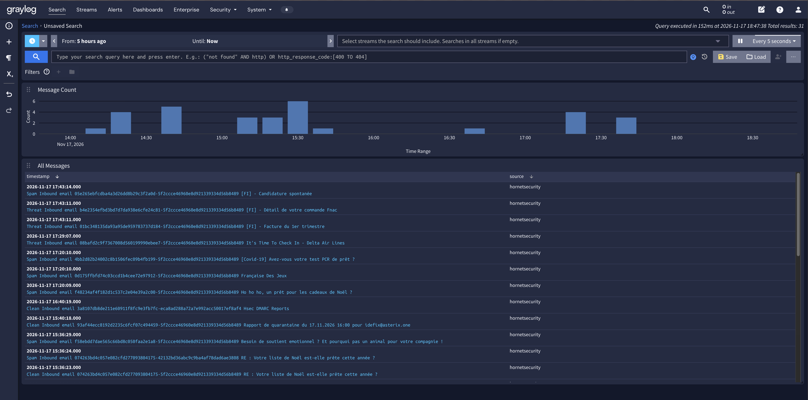
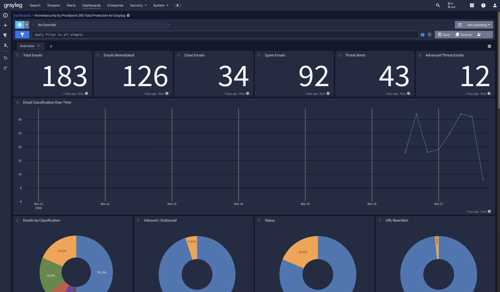

# Hornetsecurity by Proofpoint 365 Total Protection for Graylog

Native Graylog input for Hornetsecurity by Proofpoint 365 Total Protection. It collects email security events from the Control Panel API and includes a Graylog dashboard.

## Requirements

- Graylog 7.2.2 (the currently qualified version).
- Network access from the manager to the API endpoint `https://cp.hornetsecurity.com` or `https://cp.proofpoint.com`.
- A Control Panel account with read access to the target tenant or domain.

## Create a Control Panel API token

The Control Panel is available at [cp.hornetsecurity.com](https://cp.hornetsecurity.com) and [cp.proofpoint.com](https://cp.proofpoint.com). 

Create the token in either portal:

1. Open either Control Panel URL and sign in.
2. Open the menu in the top-right corner and select **User settings**.
3. On the User settings page, open the **API Token** tab.
4. Click **Create token**, enter a name for the token, then click **Create**.
5. Copy the token from the **Token details** section and store it securely.
6. The API Token tab lists your tokens, expiration dates, and other details.

Use an account authorized to read the relevant email events. Do not commit the token or paste it into issue reports or logs.

## Install and configure the plugin

1. Install `graylog-plugin-hornetsecurity-1.0.0.jar` on each Graylog server node:
   - Docker: mount it read-only into `/usr/share/graylog/plugin/`.
   - Package installation: copy it to `/usr/share/graylog-server/plugin/`.
2. Restart the Graylog server service.
3. In Graylog, open **System → Inputs**, select **Hornetsecurity by Proofpoint 365 Total Protection for Graylog**, and launch it on one node.
4. Configure the input:
   - **Title**: a name for this input.
   - **Hornetsecurity by Proofpoint scope**: tenant/domain name or numeric object ID.
   - **API token**: the token created above.
   - **Email direction**: `inbound_outbound`, `inbound`, or `outbound`.
   - **Polling interval**: 30–86400 seconds (default: 300).
   - The initial lookback is fixed at 2 hours.
5. Complete the input setup wizard.

Run one input per scope, on one Graylog node.

## Install the dashboard

1. In Graylog, open **System → Content Packs → Upload**.
2. Upload [`1.0.0/content-packs/hornetsecurity-365-total-protection-dashboard.json`](1.0.0/content-packs/hornetsecurity-365-total-protection-dashboard.json) and install the content pack.
3. Open **Dashboards → Hornetsecurity by Proofpoint 365 Total Protection for Graylog**.

## Screenshots

**Discover:** Events from the Hornetsecurity by Proofpoint 365 Total Protection for Graylog integration in Search.

**Dashboard:** Overview of events and classifications from the Hornetsecurity by Proofpoint 365 Total Protection for Graylog integration.

## License

Unless expressly stated otherwise, all software, source code, scripts, documentation, and other materials made available in this repository are proprietary to Hornetsecurity and are governed by the Hornetsecurity GitHub Content License Agreement.

By downloading, installing, accessing, or using any materials from this repository, you agree to be bound by the terms of that Agreement [LICENSE.md](LICENSE.md).

The [SECURITY.md](SECURITY.md) file explains how to report vulnerabilities.

Where any repository, file, or component is expressly subject to a separate license, including an open-source license, such separate license shall exclusively govern the relevant materials.
